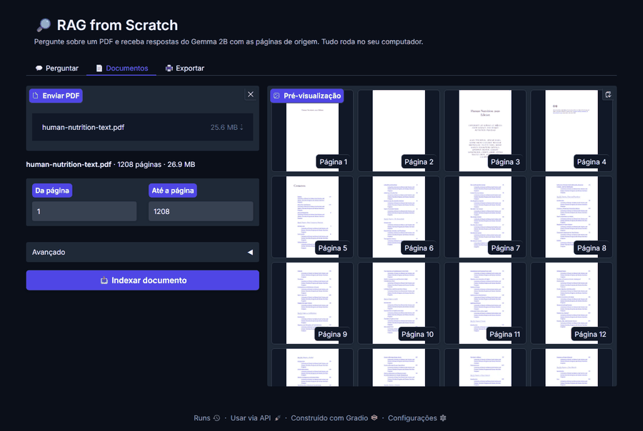

# 🔎 RAG from Scratch

Pipeline de **Retrieval-Augmented Generation (RAG)** construído do zero e rodando 100% local: sem LangChain, sem banco vetorial, sem API paga.

Envie **qualquer PDF**, faça uma pergunta **em português ou inglês** e receba uma resposta do **Gemma 2B** baseada no documento, com as páginas de onde ela saiu. Pode ser usado por uma **interface web (Gradio)** ou pela linha de comando.

- 📄 **Pré-visualização do PDF** e escolha de quais páginas indexar
- 💬 **Chat** com histórico; cada resposta mostra as fontes
- 🖨️ **Exportação** das perguntas e respostas em PDF ou HTML, ou impressão direta



## Sumário

- [Como funciona](#como-funciona)
- [Instalação](#instalação)
- [Uso](#uso)
- [Avaliação](#avaliação)
- [O que aprendi](#o-que-aprendi)
- [Limitações](#limitações)
- [Estrutura do projeto](#estrutura-do-projeto)
- [Créditos e licença](#créditos)

## Como funciona

```
                         ┌────────────── indexação (uma vez por PDF) ──────────────┐
PDF ──► texto por página ──► sentenças (spaCy) ──► chunks de 10 sentenças ──► embeddings
                                                                              (multilingual-e5)
                                                                                    │
Pergunta ──► embedding ──► 20 trechos mais parecidos (produto escalar) ◄────────────┘
                                  │
                                  ▼
                re-ranking (cross-encoder) ──► 3 melhores trechos
                                  │
                                  ▼
                   prompt (trechos + pergunta) ──► Gemma 2B ──► resposta + páginas
```

| Etapa | Arquivo | O que faz |
|---|---|---|
| 1. Ingestão | `rag/ingest.py` | Extrai o texto do PDF (PyMuPDF), quebra em sentenças e chunks e descarta trechos curtos |
| 2. Embeddings | `rag/embeddings.py` | Transforma cada trecho em um vetor de 768 números que representa o seu significado |
| 3. Busca | `rag/retrieval.py` | Acha os 20 trechos mais parecidos com a pergunta e reordena com um cross-encoder |
| 4. Geração | `rag/generation.py` | Monta o prompt com os 3 melhores trechos e gera a resposta com o Gemma |
| Tudo junto | `rag/pipeline.py` | Classe `RAG` que une as etapas; usada pela CLI e pela interface |

**Por que duas etapas na busca?**
- O **modelo de embedding** compara vetores calculados *separadamente* para a pergunta e para cada trecho. É muito rápido (~35 ms para 1680 trechos), mas às vezes impreciso.
- O **cross-encoder** lê pergunta e trecho *juntos*, como um leitor faria. É mais preciso, mas lento, por isso só olha os 20 candidatos da primeira etapa.

## Instalação

Requer Python 3.10+.

```bash
git clone https://github.com/anakarollina19/rag-from-scratch.git
cd rag-from-scratch
python -m venv .venv
.venv\Scripts\activate          # Windows  (Linux/Mac: source .venv/bin/activate)
pip install -r requirements.txt
```

O Gemma é um modelo com acesso controlado. Antes de usar:
1. aceite a licença em [huggingface.co/google/gemma-2b-it](https://huggingface.co/google/gemma-2b-it);
2. faça login com a mesma conta:

```bash
hf auth login
```

## Uso

### Interface web

```bash
python app.py
```

Abra **http://127.0.0.1:7860**. A interface tem três abas:

| Aba | O que faz |
|---|---|
| 💬 **Perguntar** | Chat com o documento ativo. A cada pergunta, o chat mostra o progresso ("buscando...", "gerando...") e depois a resposta, com as **fontes** em um bloco que abre e fecha. Na lateral: trocar de documento, número de trechos, re-ranking e geração ligada/desligada. |
| 📄 **Documentos** | Envie um PDF e veja **miniaturas das páginas** antes de indexar. Use **"Da página" / "Até a página"** para indexar só uma parte, o que é mais rápido e evita capas e anexos. Em *Avançado*: modelo de embedding e ajuste da numeração. |
| 🖨️ **Exportar** | Escolha quais perguntas entram e se as fontes aparecem, veja a **prévia** e baixe em **PDF** ou **HTML**, ou **imprima**. |

> Dica: desligue **"Gerar resposta com o Gemma"** para ver só os trechos encontrados, o que é instantâneo.

### Linha de comando

```bash
python main.py build                                  # indexa o livro de exemplo (baixa o PDF)
python main.py build meu-arquivo.pdf                  # indexa qualquer PDF
python main.py build livro.pdf --page-offset 12       # desconta 12 páginas iniciais (capa, sumário...)
python main.py search "O que é colostro?"             # só a busca
python main.py ask "What is rickets?" --sources       # busca + resposta + fontes
python main.py ask "O que é colostro?" --no-rerank    # sem re-ranking
python main.py chat                                   # modo interativo
```

`search`, `ask` e `chat` usam o PDF indexado mais recentemente. Para escolher outro, use `--index data/index/<nome>.pt`.

### Exemplo

```text
$ python main.py ask "What is rickets and what causes it?" --sources

Resposta:
**What is rickets?**
Rickets is a condition that causes soft, weak, and deformed bones that are exceptionally
susceptible to fracture. [...]
**What causes rickets?**
Vitamin D deficiency is the main cause of rickets. [...]

Fontes:
  [p. 531] score=0.812 rerank=-3.53 Vitamin D's Functional Role Activated vitamin D3 (calcitriol) [...]
```

### Tempos (CPU, sem GPU)

| Operação | Tempo |
|---|---|
| Indexar o livro (1680 trechos) | ~5 min |
| Busca | ~35 ms |
| Busca + re-ranking | ~1,4 s |
| Resposta do Gemma (com o modelo já baixado) | ~1 min |

Na primeira execução, o Gemma (~5 GB) e os outros modelos são baixados.

### Testes

```bash
python -m unittest
```

São 14 testes rápidos, que não baixam modelos: limpeza das respostas, montagem do prompt, métricas de avaliação, leitura por intervalo de páginas e geração do relatório em PDF.

## Avaliação

Para escolher os modelos com base em números e não em palpite, criei um conjunto de **22 perguntas sobre o livro de exemplo, em inglês e em português** ([eval/questions.json](eval/questions.json)). Para cada pergunta, anotei as páginas onde a resposta está, encontradas buscando termos específicos no texto (como "scurvy" e "colostrum").

```bash
python -m eval.run_eval          # compara todos os modelos, com e sem re-ranking
python -m eval.run_eval -v       # mostra o resultado de cada pergunta
```

**Métricas:**
- **hit@3:** % de perguntas em que pelo menos uma página certa está entre os 3 trechos enviados ao Gemma.
- **MRR@10:** média de 1/posição do primeiro trecho certo. Vale 1,0 se ele vem sempre em 1º lugar.

**Resultados:**

| Modelo de embedding | Re-ranking | Idioma | hit@3 | MRR@10 | ms/pergunta |
|---|---|---|---|---|---|
| all-mpnet-base-v2 | não | en | 95% | 0.87 | 32 |
| all-mpnet-base-v2 | não | pt | 36% | 0.29 | 34 |
| all-mpnet-base-v2 | sim | en | **100%** | 0.93 | 1384 |
| all-mpnet-base-v2 | sim | pt | 73% | 0.66 | 1371 |
| multilingual-e5-base | não | en | **100%** | **0.95** | 35 |
| multilingual-e5-base | não | pt | 77% | 0.75 | 35 |
| **multilingual-e5-base** | **sim** | en | **100%** | 0.91 | 1478 |
| **multilingual-e5-base** | **sim** | pt | **86%** | **0.81** | 1433 |

**Configuração escolhida (em negrito): `multilingual-e5-base` + re-ranking.**
- O modelo multilíngue é melhor até em inglês, e em português sobe de 36% para 77%.
- O re-ranking leva o português a 86%. Custa ~1,4 s por pergunta, pouco perto do ~1 min da geração.

**A métrica de busca não conta tudo.** Ela mede se os trechos certos chegam ao Gemma, não se a resposta final fica boa. Por isso também comparei respostas reais do Gemma em 4 perguntas:

| | Com re-ranking | Sem re-ranking |
|---|---|---|
| Respostas corretas | 3 de 4 | 2 de 4 |
| Respostas **erradas** (inventadas) | 0 | 1 |

Sem re-ranking, a pergunta "O que causa o escorbuto?" trouxe trechos sobre artérias, e o Gemma afirmou que escorbuto é causado por "placas na artéria". O correto é falta de vitamina C. Isso mostra o maior risco de um RAG: **com o contexto errado, o modelo responde errado com confiança**.

## O que aprendi

**1. O prompt "melhor" para um modelo grande pode quebrar um modelo pequeno.**
O notebook original usava um prompt longo, com instruções e três exemplos de resposta (*few-shot*). Com ele, o Gemma 2B respondia *"the passage does not provide information..."*, mesmo com os trechos certos. Para achar a causa, separei as etapas:
- a busca estava certa;
- o contexto chegava ao modelo (imprimi o prompt final);
- com um prompt curto e o mesmo contexto, o modelo respondia bem.

Depois, uma linha a mais no prompt (*"if the context only partly answers it, explain what the context does say"*) reduziu as recusas quando os trechos cobrem só parte da resposta.

**2. Mais contexto nem sempre é melhor.**
Com 5 trechos a resposta falhava; com 3, funcionou. Trechos extras trazem ruído, e um modelo pequeno se perde com isso.

**3. Medir antes de decidir.**
Eu esperava que o re-ranking melhorasse tudo. A avaliação mostrou que, em inglês, ele não muda o hit@3 e até baixa um pouco o MRR; o ganho real está no português e em evitar respostas erradas. Sem o conjunto de avaliação, a escolha seria um chute.

**4. Sem sorteio, as respostas ficam previsíveis.**
Com *greedy decoding* (`do_sample=False`), o modelo sempre escolhe a palavra mais provável, e as respostas ficam estáveis e reproduzíveis.

**5. Integrações escondem detalhes de tipo.**
Ao enviar um PDF pela interface, o índice era salvo mas não podia ser lido de volta:
- o Gradio entrega o caminho do arquivo como uma *subclasse* de `str`, que ia parar dentro do arquivo `.pt`;
- por segurança, o `torch.load` (`weights_only=True`) recusa tipos desconhecidos.

A correção foi uma linha: `str(pdf_path)`. O difícil foi achar a causa, lendo o *traceback* até o fim.

**6. Bugs do notebook original corrigidos:**
- regex `\.(A-Z)` → `\.([A-Z])`;
- sentenças unidas sem espaço;
- `import numpy` faltando;
- `cuda` fixo no código, o que quebrava sem GPU;
- embeddings salvos em CSV, que viravam texto.

## Limitações

- **Português do Gemma 2B:** a busca funciona bem em português, mas o Gemma 2B escreve português de forma fraca, misturando palavras em inglês ("Colostro é a milk produzida...").
- **Recusas:** com alguns trechos, o Gemma ainda responde que "o contexto não tem a informação". Exemplo: "How does saliva help with digestion?" com re-ranking.
- **Um documento por vez:** não dá para perguntar sobre vários PDFs juntos.
- **PDFs escaneados:** PDFs que são só imagem não funcionam, porque não há OCR.
- **Avaliação pequena:** são 22 perguntas sobre um único livro, e a geração foi comparada em apenas 4.

## Próximos passos

- [x] Aceitar qualquer PDF
- [x] Interface web com Gradio
- [x] GIF da interface no topo do README
- [x] Re-ranking dos resultados com um cross-encoder
- [x] Embeddings multilíngues, para perguntas em português
- [x] Conjunto de avaliação, para medir a qualidade da busca
- [x] Pré-visualização do PDF, escolha de páginas e exportação das perguntas
- [ ] Avaliar a qualidade das respostas geradas em mais perguntas
- [ ] Testar um LLM maior ou multilíngue (ex.: Gemma 2) para melhorar o português
- [ ] OCR para PDFs escaneados

## Estrutura do projeto

```
rag-from-scratch/
├── rag/                    núcleo do RAG
│   ├── config.py             modelos e parâmetros
│   ├── ingest.py             PDF → páginas → chunks
│   ├── embeddings.py         Embedder + salvar/carregar índices
│   ├── retrieval.py          busca vetorial + Reranker
│   ├── generation.py         prompt + Gemma + limpeza da resposta
│   ├── pipeline.py           classe RAG (une tudo)
│   ├── pdf_preview.py        miniaturas das páginas do PDF
│   └── report.py             relatório das perguntas (HTML e PDF)
├── eval/                   avaliação da busca
│   ├── questions.json        22 perguntas (en/pt) com as páginas certas
│   └── run_eval.py           calcula hit@3 e MRR@10
├── tests/                  testes unitários
├── scripts/
│   └── record_demo.py      grava o docs/demo.gif (Playwright)
├── docs/demo.gif
├── app.py                  interface web (Gradio)
├── main.py                 linha de comando
├── requirements.txt
└── requirements-dev.txt    + Playwright, só para gravar o GIF
```

Os arquivos gerados ficam em `data/`, que não vai para o Git:
- PDFs;
- índices em `data/index/`;
- cache da avaliação em `data/eval_cache/`;
- relatórios exportados em `data/exports/`.

## Créditos

- Baseado no notebook [RAG From Scratch](https://www.kaggle.com/code/anshulgupta1502/rag-from-scratch), de Anshul Gupta (Apache 2.0), reorganizado em módulos e ampliado com as mudanças descritas acima.
- Dados de exemplo: [Human Nutrition: 2020 Edition](https://pressbooks.oer.hawaii.edu/humannutrition2/), University of Hawai'i at Mānoa (CC BY 4.0).
- Modelos: [multilingual-e5-base](https://huggingface.co/intfloat/multilingual-e5-base), [mmarco-mMiniLMv2](https://huggingface.co/cross-encoder/mmarco-mMiniLMv2-L12-H384-v1) e [Gemma 2B](https://huggingface.co/google/gemma-2b-it).

## Licença

[Apache 2.0](LICENSE)
